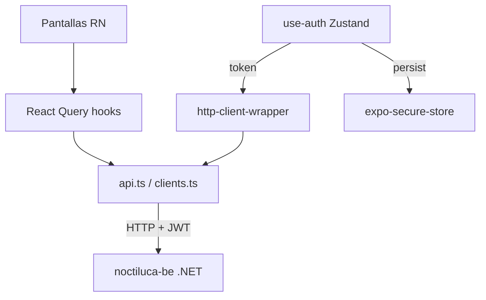
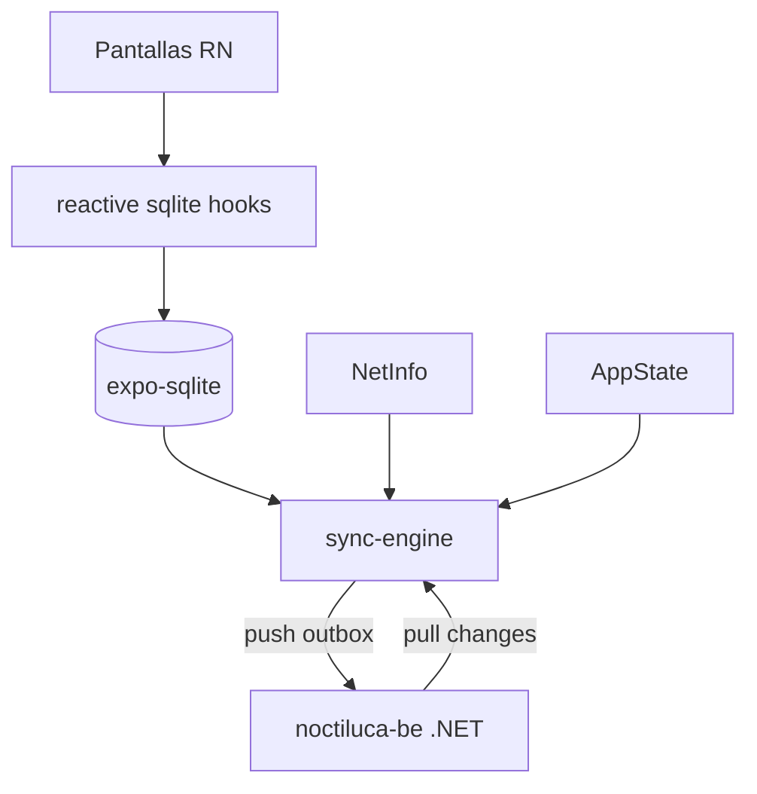

# Plan de migración: noctiluca-fe → noctiluca-app (Expo)

> Generado el 2026-08-13. Cada paso = un commit. Sin CI/CD en esta primera etapa: todo local.

---

## Índice

1. [Resumen ejecutivo](#1-resumen-ejecutivo)
2. [Tabla de dependencias: qué pasa con cada cosa](#2-tabla-de-dependencias)
3. [Arquitectura objetivo](#3-arquitectura-objetivo)
4. [Mapeo de rutas](#4-mapeo-de-rutas)
5. [Fases del plan](#5-fases-del-plan)
6. [Setup Apple Developer + EAS (pasos manuales)](#6-setup-apple-developer--eas-pasos-manuales)
7. [Estimación de esfuerzo](#7-estimación-de-esfuerzo)
8. [Primer comando ejecutable](#8-primer-comando-ejecutable)

---

## 1. Resumen ejecutivo

**Objetivo:** Reemplazar el frontend React/Vite/PWA por una app Expo (React Native) que compile para **iPhone** (distribución directa via EAS, sin App Store) y para **web** (export estático, sin PWA).

**Decisiones clave:**
- Repo nuevo: `noctiluca-app` en GitHub (noctiluca-fe queda inmutable)
- Expo managed workflow, SDK 53
- Expo Router v3 para navegación
- NativeWind v4 (Tailwind en React Native)
- Drag & drop: eliminado (sin reemplazo por ahora)
- MVP online-only primero → offline SQLite en fase posterior
- Deploy: EAS Build → distribución interna en iPhone (no App Store, no TestFlight)
- Sin CI/CD hasta una segunda etapa

**Lo que se reutiliza casi sin cambios:** todo el código TypeScript puro (sync engine logic, utils, tipos, fechas, ids, outbox compaction, lecturas-core, busqueda-core, privacidad-core).

**Lo que se reescribe:** toda la UI (componentes, pantallas, navegación).

**Lo que se elimina:** @dnd-kit, vite-plugin-pwa, workbox, sonner (reemplazado), recharts (reemplazado), react-router-dom, dexie en MVP (reintroducida como expo-sqlite en fase 7).

---

## 2. Tabla de dependencias

| Dependencia actual | Acción | Reemplazo |
|---|---|---|
| `react-router-dom` v6 | ❌ Eliminar | Expo Router v3 |
| `tailwindcss` | ❌ Eliminar | NativeWind v4 |
| `@dnd-kit/*` | ❌ Eliminar | Sin reemplazo (UI simplificada) |
| `dexie` + `dexie-react-hooks` | ⏳ Postergar (Fase 7) | `expo-sqlite` v2 + reactive hooks propios |
| `vite-plugin-pwa` / workbox | ❌ Eliminar | No aplica en RN |
| `sonner` | ❌ Reemplazar | `react-native-toast-message` |
| `recharts` | ❌ Reemplazar | `victory-native` |
| `@heroicons/react` | ❌ Reemplazar | `lucide-react-native` |
| `zustand` | ✅ Reutilizar tal cual | — |
| `@tanstack/react-query` | ✅ Reutilizar tal cual | — |
| `jwt-decode` | ✅ Reutilizar tal cual | — |
| `@fontsource/roboto` | ❌ Reemplazar | `expo-font` + Google Fonts |
| `localStorage` / `sessionStorage` | ❌ Reemplazar | `expo-secure-store` (iOS) / `AsyncStorage` (web fallback) |
| Web Crypto API | ❌ Reemplazar | `expo-crypto` |
| Web Locks API | ❌ Reemplazar | Mutex en memoria (flag booleano) |
| `navigator.onLine` / eventos online | ❌ Reemplazar | `@react-native-community/netinfo` |
| `window.addEventListener` | ❌ Reemplazar | `AppState` de React Native |
| `IndexedDB` (Dexie) | ⏳ Postergar (Fase 7) | `expo-sqlite` v2 |
| `vite` / CRACO | ❌ Eliminar | Metro bundler |
| `vitest` | ❌ Reemplazar | Jest + React Native Testing Library |
| `playwright` | ❌ Eliminar (por ahora) | — |

---

## 3. Arquitectura objetivo

```
noctiluca-app/
├── app/                          # Expo Router — pantallas
│   ├── _layout.tsx               # Root layout (providers: QueryClient, Toast)
│   ├── login.tsx                 # Pantalla de login (pública)
│   └── (app)/                    # Grupo protegido (RequiereAutenticacion)
│       ├── _layout.tsx           # Layout con IndicadorSync
│       ├── index.tsx             # Inicio (home)
│       ├── carpetas/
│       │   ├── [id].tsx          # ver-carpeta
│       │   └── nueva.tsx         # nueva-carpeta
│       ├── escritos/
│       │   ├── [carpetaId]/
│       │   │   ├── [id].tsx      # ver-escrito
│       │   │   └── nuevo.tsx     # nuevo-escrito
│       │   └── papelera/
│       │       └── [id].tsx      # ver-escrito desde papelera
│       ├── habitos/
│       │   ├── index.tsx         # habit-tracker
│       │   ├── administrar.tsx   # administrar-habitos
│       │   └── resumen.tsx       # resumen-semanal
│       ├── objetivos/
│       │   └── [carpetaId]/
│       │       └── [listaId].tsx # ver-lista + editor
│       ├── papelera/
│       │   └── index.tsx         # tacho
│       ├── modo-lectura/
│       │   └── index.tsx         # modo-lectura
│       └── carpetas-privadas/
│           └── index.tsx         # carpetas-privadas
│
├── src/
│   ├── api/                      # Reutilizar (con mínimos cambios)
│   │   ├── clients.ts            # Auto-generado — copiar tal cual
│   │   ├── api.ts                # Singleton api — adaptar URL
│   │   ├── http-client-wrapper.ts # Adaptar (SecureStore en vez de localStorage)
│   │   ├── query-keys.ts         # Copiar tal cual
│   │   └── custom-hooks/
│   │       ├── use-api-query.tsx  # Copiar tal cual
│   │       └── use-api-mutation.tsx # Adaptar toast (RN toast)
│   │
│   ├── components/
│   │   ├── ui/                   # Reescribir con RN + NativeWind
│   │   ├── requiere-autenticacion.tsx
│   │   ├── guard-sesion-privada.tsx
│   │   ├── pedir-password.tsx
│   │   └── indicador-sync.tsx
│   │
│   ├── hooks/
│   │   ├── use-auth.ts           # Adaptar (SecureStore)
│   │   ├── use-sesion-privada.ts # Adaptar (expo-crypto + SecureStore)
│   │   └── use-preferencias-habitos.ts # Copiar casi tal cual
│   │
│   ├── sync/                     # Fase 7: adaptar Dexie → expo-sqlite
│   │   ├── tipos.ts              # Copiar tal cual
│   │   ├── ids.ts                # Copiar tal cual
│   │   ├── fechas.ts             # Copiar tal cual
│   │   ├── lecturas-core.ts      # Copiar tal cual
│   │   ├── busqueda-core.ts      # Copiar tal cual
│   │   ├── outbox.ts             # Copiar casi tal cual
│   │   ├── db.ts                 # Reescribir: Dexie → expo-sqlite
│   │   ├── sync-engine.ts        # Adaptar: Web Locks → flag, Dexie → sqlite
│   │   ├── estado-sync.ts        # Copiar tal cual (Zustand)
│   │   ├── lecturas.ts           # Reescribir: useLiveQuery → reactive hooks
│   │   ├── repositorio-*.ts      # Adaptar: Dexie ops → sqlite ops
│   │   └── ...
│   │
│   ├── privacidad/
│   │   └── privacidad-core.ts    # Adaptar (expo-crypto)
│   │
│   └── utils/
│       ├── utilidades.ts         # Copiar tal cual
│       ├── frases-inicio.ts      # Copiar tal cual
│       └── requiere-online.ts    # Adaptar (NetInfo)
│
├── app.json                      # Config Expo (bundle ID, íconos, permisos)
├── eas.json                      # Config EAS Build
├── tailwind.config.js            # NativeWind config
├── metro.config.js               # Metro bundler config
├── babel.config.js               # Babel con NativeWind preset
├── jest.config.js                # Jest config
└── tsconfig.json                 # TypeScript config
```

### Diagrama de flujo de datos (MVP online-only)



### Diagrama de flujo de datos (Fase 7: offline-first)



---

## 4. Mapeo de rutas

| ruta actual (HashRouter) | Expo Router path | Notas |
|---|---|---|
| `/login` | `app/login.tsx` | Pública |
| `/` (inicio) | `app/(app)/index.tsx` | Tab principal |
| `carpetas/:id/escritos` | `app/(app)/carpetas/[id].tsx` | ver-carpeta muestra sus escritos |
| `nueva-carpeta` | `app/(app)/carpetas/nueva.tsx` | |
| `:carpetaId/nuevo` | `app/(app)/escritos/[carpetaId]/nuevo.tsx` | |
| `:carpetaId/escritos/ver/:id` | `app/(app)/escritos/[carpetaId]/[id].tsx` | |
| `papelera` | `app/(app)/papelera/index.tsx` | |
| `papelera/ver/:id` | `app/(app)/papelera/[id].tsx` | |
| `modo-lectura` | `app/(app)/modo-lectura/index.tsx` | |
| `habitos` | `app/(app)/habitos/index.tsx` | |
| `resumen-habitos` | `app/(app)/habitos/resumen.tsx` | |
| `:carpetaId/lista-objetivos/:listaId` | `app/(app)/objetivos/[carpetaId]/[listaId].tsx` | |
| `carpetas-privadas` | `app/(app)/carpetas-privadas/index.tsx` | |

---

## 5. Fases del plan

> Cada paso debajo de una fase es un **commit**. Formato: `[Fase X.Y] objetivo del commit`.

---

### Fase 0 — Bootstrap del repo (estimado: ~1-2 horas)

**Objetivo:** Tener el repo GitHub creado, Expo inicializado con NativeWind y Jest configurado. Cero funcionalidad todavía.

---

**Paso 0.1 — Crear repo GitHub e inicializar Expo**

Objetivo: repo público `noctiluca-app` en GitHub con Expo SDK 53 + TypeScript + Expo Router.

Comandos:
```bash
# En /Users/mana/Sources/noctiluca/ (o donde corresponda)
npx create-expo-app@latest noctiluca-app --template blank-typescript
cd noctiluca-app
npx expo install expo-router expo-constants expo-linking expo-status-bar react-native-safe-area-context react-native-screens
gh repo create noctiluca-app --public --source=. --remote=origin --push
```

`app.json` mínimo:
```json
{
  "expo": {
    "name": "Noctiluca",
    "slug": "noctiluca",
    "version": "1.0.0",
    "scheme": "noctiluca",
    "platforms": ["ios", "web"],
    "ios": {
      "bundleIdentifier": "com.mmanna3.noctiluca",
      "supportsTablet": false
    },
    "web": {
      "bundler": "metro",
      "output": "static"
    },
    "plugins": ["expo-router"]
  }
}
```

Tests: `yarn expo start` sin errores en consola.

---

**Paso 0.2 — Configurar NativeWind v4 + ESLint + Prettier**

Objetivo: poder usar clases Tailwind en componentes RN. ESLint + Prettier con las mismas reglas del proyecto (tabs, comillas dobles, español).

Comandos:
```bash
yarn add nativewind
yarn add --dev tailwindcss prettier eslint @typescript-eslint/eslint-plugin @typescript-eslint/parser eslint-plugin-react eslint-plugin-react-hooks eslint-config-prettier
npx tailwindcss init
```

Archivos a crear/configurar:
- `tailwind.config.js` — misma paleta de colores que usa el fe actual
- `metro.config.js` — `withNativeWind`
- `babel.config.js` — preset `nativewind/babel`
- `global.css` — directivas Tailwind
- `.eslintrc.js` — misma config que noctiluca-fe
- `.prettierrc` — tabs, comillas dobles

Tests: componente `<Text className="text-slate-900">Hola</Text>` renderiza sin errores en Expo Go / simulador.

---

**Paso 0.3 — Configurar Jest + React Native Testing Library**

Objetivo: `yarn test` corre sin errores con al menos un test trivial.

Comandos:
```bash
yarn add --dev jest jest-expo @testing-library/react-native @testing-library/jest-native
```

`jest.config.js`:
```js
module.exports = {
    preset: "jest-expo",
    setupFilesAfterFramework: ["@testing-library/jest-native/extend-expect"],
    transformIgnorePatterns: [
        "node_modules/(?!((jest-)?react-native|@react-native(-community)?)|expo(nent)?|@expo(nent)?/.*|@expo-google-fonts/.*|react-navigation|@react-navigation/.*|@unimodules/.*|unimodules|sentry-expo|native-base|react-native-svg)"
    ]
};
```

Tests: test trivial `expect(1).toBe(1)` pasa.

---

**Paso 0.4 — Configurar EAS + registrar dispositivo iPhone**

Objetivo: `eas` CLI configurado, `eas.json` creado, UDID del iPhone registrado en Apple Developer.

```bash
npm install -g eas-cli
eas login   # con cuenta expo del usuario
eas build:configure
```

`eas.json`:
```json
{
    "cli": { "version": ">= 7.0.0" },
    "build": {
        "development": {
            "developmentClient": true,
            "distribution": "internal",
            "ios": { "simulator": false }
        },
        "internal": {
            "distribution": "internal",
            "ios": { "resourceClass": "m-medium" }
        },
        "production": {
            "distribution": "store"
        }
    }
}
```

Registrar dispositivo:
```bash
eas device:create
# Sigue el link → instala perfil de gestión en iPhone → registra UDID automáticamente
```

Tests: `eas whoami` muestra el usuario. `eas device:list` muestra el iPhone.

> ⚠️ **Acción manual requerida:** abrir el link de `eas device:create` desde el iPhone para registrar su UDID.

---

### Fase 1 — Capa base no-UI (estimado: ~2-3 horas)

**Objetivo:** Toda la lógica pura TypeScript portada y testeada. Sin UI todavía.

---

**Paso 1.1 — Copiar utilidades puras**

Archivos a copiar sin modificar desde `noctiluca-fe/src/`:
- `sync/tipos.ts`
- `sync/ids.ts`
- `sync/fechas.ts`
- `sync/lecturas-core.ts`
- `sync/busqueda-core.ts`
- `sync/outbox.ts` (solo la lógica de compactación — sin Dexie)
- `utils/utilidades.ts`
- `utils/frases-inicio.ts`
- `pantallas/habitos/utilidades-habitos.ts`
- `pantallas/objetivos/utilidades-objetivos.ts`

Tests a copiar/adaptar (cambiar `vitest` → `jest` imports):
- `sync/fechas.test.ts`
- `sync/lecturas-core.test.ts`
- `sync/busqueda-core.test.ts`
- `sync/outbox.test.ts`
- `utils/utilidades.test.ts` (si aplica)
- `pantallas/objetivos/utilidades-objetivos.test.ts`

Los tests de lógica pura deben pasar sin cambios (salvo reemplazar `describe`/`it`/`expect` de vitest por jest, que es compatible).

---

**Paso 1.2 — Port API layer**

Archivos a adaptar:
- `src/api/clients.ts` → copiar tal cual (es TypeScript puro, sin imports web)
- `src/api/query-keys.ts` → copiar tal cual
- `src/api/api.ts` → adaptar: la URL base viene de `expo-constants` (variable de entorno)
- `src/api/http-client-wrapper.ts` → adaptar: quitar `localStorage`, usar store Zustand directamente (sin cambio de fondo, ya lo hace)
- `src/api/custom-hooks/use-api-query.tsx` → copiar tal cual
- `src/api/custom-hooks/use-api-mutation.tsx` → adaptar: reemplazar `sonner` toast por `react-native-toast-message`

Instalar dependencias:
```bash
npx expo install expo-constants
yarn add @tanstack/react-query react-native-toast-message jwt-decode
```

Variables de entorno en `app.json`:
```json
{
  "expo": {
    "extra": {
      "apiUrl": "https://TU_URL_PRODUCCION/api"
    }
  }
}
```

Uso en `api.ts`:
```typescript
import Constants from "expo-constants";
const API_URL = Constants.expoConfig?.extra?.apiUrl ?? "http://localhost:5072/api";
```

Tests:
- Test unitario de `http-client-wrapper`: verifica que agrega header `Authorization: Bearer TOKEN` cuando hay token.
- Test unitario de `use-api-query`: verifica que `activado: false` no dispara la query.

---

**Paso 1.3 — Port auth (Zustand + SecureStore)**

Archivos a adaptar:
- `src/hooks/use-auth.ts` → reemplazar `localStorage` por `expo-secure-store`

```bash
npx expo install expo-secure-store
yarn add zustand
```

La persistencia de Zustand cambia:

```typescript
// En vez de:
// storage: createJSONStorage(() => localStorage)

// Usar:
import * as SecureStore from "expo-secure-store";
import AsyncStorage from "@react-native-async-storage/async-storage";
import { Platform } from "react-native";

const storage = Platform.OS === "web"
    ? createJSONStorage(() => AsyncStorage)
    : {
        getItem: (key: string) => SecureStore.getItemAsync(key),
        setItem: (key: string, value: string) => SecureStore.setItemAsync(key, value),
        removeItem: (key: string) => SecureStore.deleteItemAsync(key),
    };
```

Para web, usar `@react-native-async-storage/async-storage`:
```bash
npx expo install @react-native-async-storage/async-storage
```

Tests a copiar/adaptar:
- Mockear `expo-secure-store` en Jest
- Verificar que `login()` guarda token, `logout()` lo borra
- Verificar que `isAuthenticated` es `false` cuando no hay token

---

**Paso 1.4 — Port privacidad-core + use-sesion-privada**

Adaptar `privacidad/privacidad-core.ts`:
- Reemplazar `crypto.subtle.digest` (Web Crypto) por `expo-crypto`

```bash
npx expo install expo-crypto
```

```typescript
// En vez de:
// const hashBuffer = await crypto.subtle.digest("SHA-256", msgBuffer);

import * as Crypto from "expo-crypto";
const hash = await Crypto.digestStringAsync(
    Crypto.CryptoDigestAlgorithm.SHA256,
    password
);
```

Adaptar `src/hooks/use-sesion-privada.ts`:
- Reemplazar `sessionStorage` por un store Zustand en memoria (sin persistencia — la sesión privada debe vencer al cerrar la app, igual que `sessionStorage`)

Tests a copiar/adaptar:
- `privacidad/privacidad-core.test.ts` (mockear `expo-crypto`)
- `hooks/use-sesion-privada.test.ts` (mockear `expo-crypto`)

---

### Fase 2 — Componentes UI base (estimado: ~3-4 horas)

**Objetivo:** Tener todos los componentes UI base funcionando con NativeWind. Sin pantallas completas todavía.

---

**Paso 2.1 — Componentes UI primitivos**

Reescribir `src/components/ui/` adaptando de React DOM → React Native:

| Componente web | Componente RN | Notas |
|---|---|---|
| `<div>` | `<View>` | |
| `<button>` | `<TouchableOpacity>` / `<Pressable>` | |
| `<input>` | `<TextInput>` | |
| `<textarea>` | `<TextInput multiline>` | |
| `<span>`, `<p>` | `<Text>` | **Todo texto en RN va en `<Text>`** |
| `<ul>`, `<li>` | `<FlatList>` / `<View>` | |
| CSS `position: fixed` | Sin equivalente exacto — usar `Modal` o posicionamiento RN | |

Componentes a crear:
- `Boton` + `BotonIcono` (reemplaza `botones.tsx`)
- `InputUI` (reemplaza `input-ui.tsx`)
- `TextareaUI` (reemplaza `textarea.tsx`)
- `CardUI` (reemplaza `card.tsx`)
- `Cuerpo` (reemplaza `cuerpo.tsx` — padding container)
- `Encabezado` (reemplaza `encabezado.tsx` — header bar con SafeAreaView)
- `ListaItem` (reemplaza `lista-item.tsx`)
- `LoadingSpinner` (reemplaza `loading-spinner.tsx` — usar `ActivityIndicator`)
- `PuntoMarcador` (reemplaza `punto-marcador.tsx`)
- `AvisoSoloOnline` (reemplaza `aviso-solo-online.tsx`)

Instalar iconos:
```bash
yarn add lucide-react-native
npx expo install react-native-svg
```

Tests:
- Tests de render para `Boton`, `InputUI`, `Encabezado` con React Native Testing Library
- Verificar que clases NativeWind se aplican (snapshot test)

---

**Paso 2.2 — Modal seleccionar carpeta + selector criterio orden**

Reescribir:
- `ui/modal-seleccionar-carpeta.tsx` → usar `Modal` de React Native + `FlatList`
- `ui/selector-criterio-orden.tsx` → `Picker` de `@react-native-picker/picker` o implementar dropdown custom con `Modal`

```bash
npx expo install @react-native-picker/picker
```

Tests: test de render, verificar que el modal abre/cierra correctamente.

---

**Paso 2.3 — IndicadorSync**

Copiar/adaptar `src/components/indicador-sync.tsx`:
- Adaptar de clases CSS a NativeWind
- Estado-sync (Zustand) reutilizar tal cual

Tests: copiar/adaptar `indicador-sync.test.tsx`.

---

**Paso 2.4 — Auth guards**

Reescribir:
- `requiere-autenticacion.tsx` → usar Expo Router `<Redirect>` en vez de React Router `<Navigate>`
- `guard-sesion-privada.tsx` → adaptar lógica (igual) + adaptar navegación
- `pedir-password.tsx` → adaptar a RN Modal

Tests: copiar/adaptar `guard-sesion-privada.test.tsx`.

---

### Fase 3 — Navegación + pantallas MVP (estimado: ~4-6 horas)

**Objetivo:** App navegable con login, carpetas y escritos funcionando online-only. Primer MVP usable.

---

**Paso 3.1 — Root layout + providers**

Crear `app/_layout.tsx`:
```typescript
import { QueryClient, QueryClientProvider } from "@tanstack/react-query";
import { Stack } from "expo-router";
import Toast from "react-native-toast-message";
import { SafeAreaProvider } from "react-native-safe-area-context";

const queryClient = new QueryClient({
    defaultOptions: {
        queries: { staleTime: 5 * 60 * 1000, gcTime: 10 * 60 * 1000, retry: 1 }
    }
});

export default function RootLayout() {
    return (
        <QueryClientProvider client={queryClient}>
            <SafeAreaProvider>
                <Stack screenOptions={{ headerShown: false }} />
                <Toast />
            </SafeAreaProvider>
        </QueryClientProvider>
    );
}
```

Tests: el layout renderiza sin errores.

---

**Paso 3.2 — Pantalla de login**

Portar `pantallas/login/login.tsx` a `app/login.tsx`.
- Adaptar de HTML a RN
- Usar `useRouter().replace("/(app)")` en vez de `useNavigate()`
- NativeWind para estilos

Tests: login form renderiza, botón dispara submit.

---

**Paso 3.3 — Layout de app protegida**

Crear `app/(app)/_layout.tsx`:
- Verifica autenticación (`useAuth`) → `<Redirect href="/login" />` si no autenticado
- Renderiza `<IndicadorSync>` en header
- Stack navigation con `<Stack />`

Tests: sin token → redirige a login, con token → renderiza children.

---

**Paso 3.4 — Pantalla Inicio (home)**

Portar `pantallas/inicio.tsx` a `app/(app)/index.tsx`.

En MVP online-only: obtener carpetas raíz via React Query (llamada directa a API, sin Dexie).
- Crear hook `useApiCarpetasRaiz()` que use `useApiQuery` con `api.obtenerCarpetasRaiz()`
- El HabitTracker widget y ObjetivosDiaWidget pueden quedar como placeholders en esta fase

Tests: pantalla renderiza lista de carpetas mockeadas.

---

**Paso 3.5 — Pantallas Carpetas**

Portar a:
- `app/(app)/carpetas/[id].tsx` (ver-carpeta + lista de escritos)
- `app/(app)/carpetas/nueva.tsx` (crear/editar carpeta)

MVP: datos via React Query directo a API. Sin drag-drop (lista simple con `FlatList`).

Portar componentes auxiliares:
- `encabezado-normal.tsx` → adaptado a RN
- `encabezado-seleccion.tsx` → adaptado a RN
- `barra-de-herramientas.tsx` → adaptado a RN
- `estado-vacio.tsx` → adaptado a RN
- `lista-item.tsx` (carpetas) → adaptado a RN

Tests: copiar/adaptar `ver-carpeta.test.tsx`, `nueva-carpeta.test.tsx`.

---

**Paso 3.6 — Pantallas Escritos + autosave**

Portar:
- `app/(app)/escritos/[carpetaId]/[id].tsx` (ver-escrito)
- `app/(app)/escritos/[carpetaId]/nuevo.tsx` (nuevo-escrito)
- `src/pantallas/escritos/usar-autoguardado.ts` → copiar/adaptar (lógica pura, sin Dexie en MVP: llama API directamente)
- `cuerpo-escrito.tsx` → `<TextInput multiline>` con NativeWind
- `encabezado-escrito.tsx` → adaptado a RN

Tests: copiar/adaptar `ver-escrito.test.tsx`, `usar-autoguardado.test.tsx`.

---

**Paso 3.7 — Pantalla Papelera**

Portar `pantallas/tacho/tacho.tsx` a `app/(app)/papelera/index.tsx`.
MVP: datos via React Query.

Tests: pantalla renderiza lista vacía cuando no hay elementos en papelera.

---

### Fase 4 — Primer deploy en iPhone (estimado: ~1-2 horas)

**Objetivo:** App instalada en el iPhone del usuario, funcionando con el backend de producción.

---

**Paso 4.1 — Configurar URL de producción + build**

1. Setear la URL real del backend en `app.json` → `extra.apiUrl`
2. Asegurarse que el backend acepta conexiones HTTPS desde external (CORS si aplica)
3. Ejecutar:
```bash
eas build --platform ios --profile internal
```
4. Cuando termine (~10-15 min en servidores de Expo), descargar el `.ipa`
5. Instalar en iPhone: EAS envía un link, abrirlo desde Safari en el iPhone → "Instalar"

> ⚠️ **Requisito previo:** el UDID del iPhone debe estar registrado (Paso 0.4).
> ⚠️ Si es la primera vez con este bundle ID, puede pedir crear el App ID en Apple Developer Portal. EAS lo hace automáticamente si se le dan permisos.

Tests: la app abre en el iPhone, el login funciona contra el backend de producción.

---

### Fase 5 — Web target (estimado: ~2-3 horas)

**Objetivo:** `npx expo export --platform web` genera un sitio estático funcional.

---

**Paso 5.1 — Verificar y arreglar incompatibilidades web**

Problemas comunes al exportar a web desde Expo:
- `expo-secure-store` no funciona en web → ya manejado con fallback `AsyncStorage` (Paso 1.3)
- `react-native-screens` necesita configuración web
- Iconos `lucide-react-native` + `react-native-svg` necesitan `react-native-svg-web`

```bash
yarn add react-native-svg-web
```

Agregar en `metro.config.js`:
```js
config.resolver.alias = {
    "react-native-svg": "react-native-svg-web"
};
```

Tests: `npx expo export --platform web` sin errores, abrir `dist/index.html` en browser.

---

**Paso 5.2 — Deploy web estático**

Opción A (más simple): GitHub Pages via GitHub Actions o manual.
```bash
npx expo export --platform web
# subir carpeta dist/ a GitHub Pages o al wwwroot del backend
```

Opción B: servir desde el backend .NET `wwwroot/` (mismo approach que el fe actual).

Tests: la web funciona en Chrome, login funciona, navegación funciona.

---

### Fase 6 — Features secundarias (estimado: ~4-6 horas)

**Objetivo:** Paridad funcional completa (hábitos, objetivos, modo lectura, carpetas privadas).

---

**Paso 6.1 — Hábitos: habit-tracker + administrar**

Portar:
- `app/(app)/habitos/index.tsx` (habit-tracker semanal)
- `app/(app)/habitos/administrar.tsx` (crear, reordenar — sin drag-drop, usar botones arriba/abajo)
- Componentes: `habit-tracker-grid.tsx`, `habit-tracker-celda.tsx`, `menu-habitos.tsx`
- `use-preferencias-habitos.ts` → adaptar AsyncStorage/SecureStore

MVP: datos via React Query.

Tests: copiar tests relevantes de habit-tracker.

---

**Paso 6.2 — Hábitos: resumen semanal (gráfico)**

Instalar Victory Native:
```bash
yarn add victory-native
npx expo install react-native-reanimated react-native-gesture-handler
```

Portar `resumen-semanal.tsx` de Recharts → Victory Native.
- `<BarChart>` Recharts → `<VictoryBar>` Victory
- La lógica de datos (qué mostrar) es reutilizable

Tests: componente renderiza sin errores con datos mockeados.

---

**Paso 6.3 — Objetivos**

Portar:
- `app/(app)/objetivos/[carpetaId]/[listaId].tsx`
- Modo ver-lista + modo editor (sin drag-drop — reordenar con botones)
- `planificacion-objetivos-dia.tsx` → widget en home o pantalla propia

Tests: copiar/adaptar `planificacion-objetivos-dia.test.tsx`.

---

**Paso 6.4 — Modo lectura + carpetas privadas**

Portar:
- `app/(app)/modo-lectura/index.tsx` (leer todos los escritos, búsqueda)
- `app/(app)/carpetas-privadas/index.tsx` + `pedir-password.tsx` integrado
- Flujo de sesión privada completo con `guard-sesion-privada`

Tests: carpetas privadas requieren password, sesión expira.

---

### Fase 7 — SQLite + sync offline (estimado: ~5-8 horas)

**Objetivo:** Reemplazar React Query directo → arquitectura offline-first con expo-sqlite, igual al fe actual.

> Esta fase es la más compleja. El sync engine actual (outbox, compactación, pull/push) está bien diseñado en TypeScript puro — la mayor parte se reutiliza.

---

**Paso 7.1 — Schema SQLite (reemplaza db.ts/Dexie)**

Instalar:
```bash
npx expo install expo-sqlite
```

Crear `src/sync/db.ts` con expo-sqlite v2:
```typescript
import * as SQLite from "expo-sqlite";

const db = SQLite.openDatabaseSync("noctiluca.db");

db.execSync(`
    CREATE TABLE IF NOT EXISTS escritos (
        clientId TEXT PRIMARY KEY,
        serverId TEXT,
        carpetaPadreClientId TEXT,
        titulo TEXT,
        cuerpo TEXT,
        enPapelera INTEGER DEFAULT 0,
        eliminado INTEGER DEFAULT 0,
        updatedAt TEXT
    );
    -- ... resto de tablas (carpetas, habitos, registrosHabito, listasObjetivo, itemsObjetivo, outbox, meta)
`);
```

Tests: tablas se crean correctamente, insertar/leer un registro.

---

**Paso 7.2 — Sistema de queries reactivas (reemplaza useLiveQuery)**

Crear `src/sync/use-live-query.ts`:
```typescript
import { useEffect, useState } from "react";
import * as SQLite from "expo-sqlite";

// expo-sqlite v2 tiene addUpdateListener para cambios en tablas
export function useLiveQuery<T>(query: () => T, deps: string[]): T {
    const [resultado, setResultado] = useState<T>(() => query());

    useEffect(() => {
        const subscription = db.addUpdateListener(() => {
            setResultado(query());
        });
        return () => subscription.remove();
    }, deps);

    return resultado;
}
```

Tests: el hook re-renderiza cuando cambia la DB.

---

**Paso 7.3 — Repositorios (reemplaza repositorio-*.ts)**

Adaptar cada repositorio:
- `repositorio-escritos.ts`: reemplazar `db.escritos.put()` → `db.runSync("INSERT OR REPLACE INTO escritos...")`
- Mismo patrón para carpetas, habitos, objetivos
- La lógica de outbox se mantiene igual

Tests: crear/editar/eliminar registros, verificar que aparecen en outbox.

---

**Paso 7.4 — lecturas.ts (reemplaza useLiveQuery de Dexie)**

Adaptar `src/sync/lecturas.ts`:
- Reemplazar `useLiveQuery(async () => db.carpetas.toArray())` por queries SQLite reactivas
- `lecturas-core.ts` no cambia (es lógica pura)

Tests: `usarCarpetasRaiz()` retorna datos del SQLite, se actualiza al modificar.

---

**Paso 7.5 — sync-engine.ts (adaptar a RN)**

Cambios necesarios:
- **Web Locks → flag booleano:** en RN no hay pestañas concurrentes, un `let sincronizando = false` alcanza
- **`navigator.onLine` → `NetInfo`:**
```bash
npx expo install @react-native-community/netinfo
```
- **`window.addEventListener("online")` → `NetInfo.addEventListener`**
- **`document.addEventListener("visibilitychange")` → `AppState.addEventListener`**
- La lógica de push/pull no cambia

Tests: sync no se ejecuta dos veces en paralelo (flag), sync se dispara al volver a estar online.

---

## 6. Setup Apple Developer + EAS (pasos manuales)

Estos pasos los hace el usuario una sola vez, no son parte de ningún commit.

### Checklist

- [ ] **App ID en Apple Developer Portal:** ir a [developer.apple.com](https://developer.apple.com) → Identifiers → Crear App ID con Bundle ID `com.mmanna3.noctiluca` (o el que elijas)
- [ ] **Registrar dispositivo:** correr `eas device:create` y abrir el link desde el iPhone (Paso 0.4)
- [ ] **Login en EAS:** `eas login` con cuenta expo.dev
- [ ] **Credenciales Apple en EAS:** al correr el primer `eas build`, EAS pedirá automáticamente crear certificados y provisioning profiles con Apple. Necesitás las credenciales de tu Apple Developer account.
- [ ] **EXPO_TOKEN para scripts locales (opcional):** `eas whoami --json` y guardar el token si querés automatizar luego

### Para instalar el IPA en el iPhone (sin App Store)

1. `eas build --platform ios --profile internal` → esperar ~10-15 min
2. EAS manda un email con link de descarga + un QR
3. Abrir el link desde **Safari en el iPhone** (no Chrome)
4. Tocar "Instalar" → la app aparece en la pantalla de inicio
5. En iPhone: Configuración → General → VPN y gestión del dispositivo → Confiar en el certificado del desarrollador

---

## 7. Estimación de esfuerzo

| Fase | Pasos | Estimado | Notas |
|---|---|---|---|
| Fase 0: Bootstrap | 4 pasos | ~1-2 h | Comandos claros, poca ambigüedad |
| Fase 1: Capa base | 4 pasos | ~2-3 h | La mayoría es copiar + mínima adaptación |
| Fase 2: UI base | 4 pasos | ~3-4 h | Reescritura HTML→RN es mecánica pero requiere atención |
| Fase 3: Pantallas MVP | 7 pasos | ~4-6 h | La mayor parte del rewrite de UI |
| Fase 4: Deploy iPhone | 1 paso | ~1-2 h | Dependiente de EAS + Apple setup |
| Fase 5: Web | 2 pasos | ~2-3 h | Bugs de compatibilidad inesperados posibles |
| Fase 6: Features secundarias | 4 pasos | ~4-6 h | Hábitos, objetivos, privadas |
| Fase 7: SQLite offline | 5 pasos | ~5-8 h | La más compleja técnicamente |
| **Total MVP (Fases 0-4)** | | **~12-18 h** | **~2-3 días con IA ayudando** |
| **Total paridad completa** | | **~22-34 h** | **~4-7 días** |

---

## 8. Primer comando ejecutable

Cuando estés listo para empezar, decime y ejecutamos el Paso 0.1:

```bash
# Desde /Users/mana/Sources/noctiluca/ (o el directorio que prefieras)
npx create-expo-app@latest noctiluca-app --template blank-typescript
```

Podemos ir paso a paso (vos me decís "seguí") o a más velocidad si querés.

---

*Plan generado para el proyecto noctiluca — mmanna3@gmail.com — 2026-08-13*
